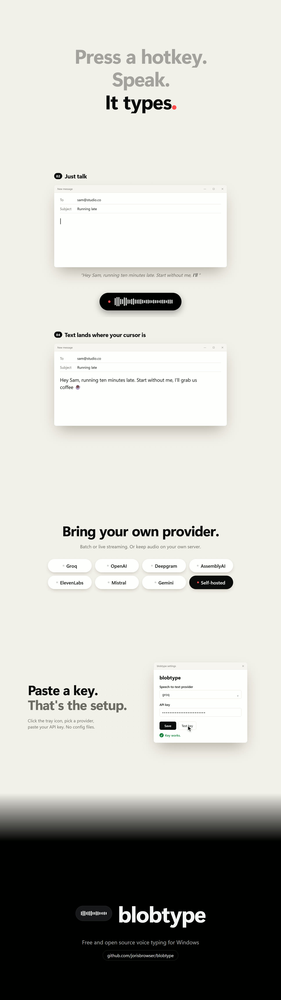

<h1 align="center">blobtype</h1>

<p align="center"><b>Press a shortcut, speak, and your words are typed into any app.</b><br />Free and open source voice typing for Windows.</p>

<p align="center">
  <a href="../../releases/latest"><b>Download</b></a> ·
  <a href="docs/media/demo.mp4">Video with sound</a> ·
  <a href="https://ko-fi.com/jorisv">Buy me a coffee</a>
</p>

<p align="center"></p>

## Install

1. Download the `x64-setup.exe` installer from [Releases](../../releases/latest) and run it.
2. A short setup opens: pick a speech service, paste your API key, done.
   [Groq](https://console.groq.com/keys) is free to start.
3. Press `Ctrl + Space`, talk, press it again. The text appears where your cursor is.

Settings are one click away: click the blobtype icon in the tray, next to the clock.

> blobtype is free and open source. If it saves you time, you can support it with a coffee.
>
> <a href="https://ko-fi.com/jorisv"></a>

## Features

- Works in every app: mail, chat, docs, code editors.
- A small overlay with a live waveform shows when it is listening, with the shortcuts you can press next to it. `Esc` cancels.
- Text went to the wrong window? `Ctrl + Shift + Space` types your last dictation again. Your clipboard is never touched.
- Choose your service: Groq, OpenAI, Deepgram, ElevenLabs, AssemblyAI, Mistral, Google Gemini, or your own Whisper server.
- Live typing (OpenAI, Deepgram): words appear while you speak.
- Mutes you in Discord while you dictate (optional, in Advanced settings).
- Stays out of the way in games: the shortcuts are paused while a fullscreen app has focus.
- Private: audio stays in memory and only goes to the service you picked. No telemetry, no account.

## At a glance

<p align="center"></p>

## FAQ

**What does it cost?** blobtype is free. The speech service bills you directly, usually a fraction of a cent
per minute. Groq and Gemini have free tiers.

**Text does not show up in an app.** Windows blocks typing into apps that run as administrator. Run blobtype
as administrator too, or switch *Insert text by* to *Pasting* in Advanced settings.

**The shortcut does nothing.** Another app probably uses it. Pick a different one in settings.

**Games?** While a fullscreen game has focus, blobtype pauses its shortcuts and types nothing, so the game
gets your keys. Do not dictate into a game window itself: anti-cheat software may dislike simulated typing.

## Build from source

Needs [Rust](https://rustup.rs) and the [Tauri prerequisites](https://tauri.app/start/prerequisites/).

```
cargo install tauri-cli --version "^2" --locked
cargo tauri dev      # run
cargo tauri build    # installer in target/release/bundle/nsis
```

Power users can edit `%APPDATA%\blobtype\config.toml` directly (see [config.example.toml](config.example.toml)).

## Support

blobtype is free and stays free. If it saves you time and you want to say thanks, you can
buy me a coffee on Ko-fi.

<a href="https://ko-fi.com/jorisv"></a>

[Contributing](CONTRIBUTING.md) · [Security](SECURITY.md) · [GPL-3.0 License](LICENSE)
